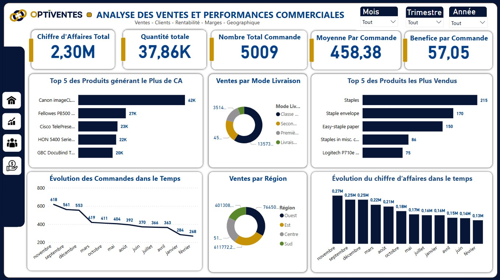
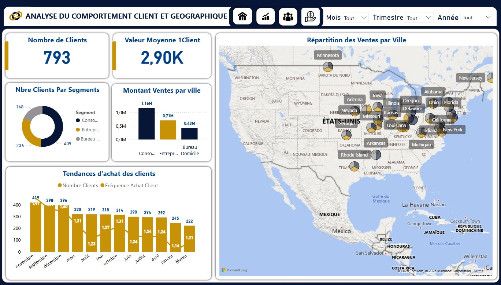
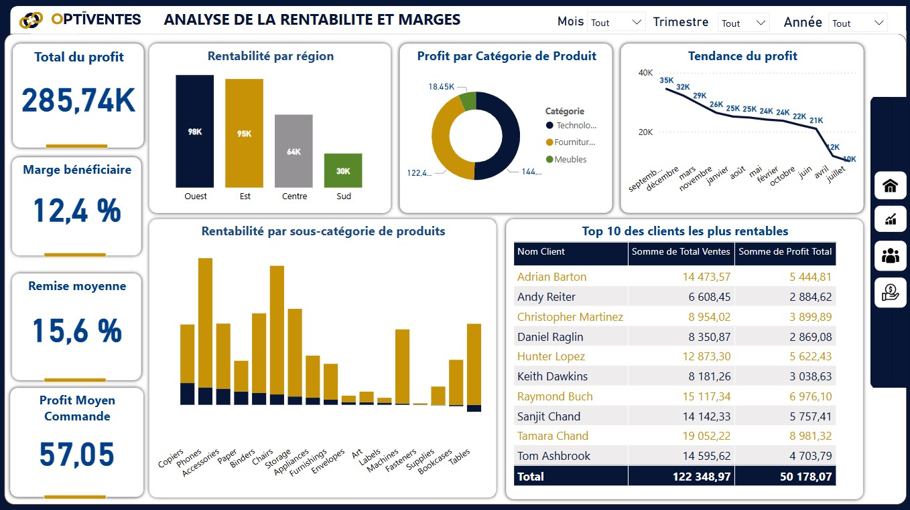

# 📊 OPTIVENTES 360 — Analyse des ventes et performances commerciales


> Tableau de bord Power BI interactif pour piloter les ventes, comprendre le comportement des clients et optimiser la rentabilité d'une entreprise de distribution.
> Projet de fin de formation Data Analyst — **GoMyCode Côte d'Ivoire** (février 2025).

---

## 🎯 Contexte et objectifs

Le commerce et la grande distribution génèrent de grands volumes de données, souvent sous-exploités.
Ce projet transforme les données de ventes brutes en un outil d'aide à la décision.

**Objectifs :**
- Analyser les ventes et les performances commerciales
- Comprendre le comportement des clients (segments, régions)
- Mesurer la rentabilité et identifier les leviers d'amélioration des marges

## 🗂️ Données

| Élément | Détail |
|---|---|
| Source | Dataset public de ventes retail (Kaggle) |
| Volume | +10 000 transactions |
| Dimensions | Clients, produits (catégories), régions, segments, dates |
| Mesures | Chiffre d'affaires, quantités, remises, profit |

## ⚙️ Méthodologie

1. **Nettoyage et transformation (Power Query)** : suppression des valeurs aberrantes, normalisation des dates et des montants.
2. **Modélisation** : schéma en étoile (tables de faits et de dimensions) avec des relations optimisées.
3. **Mesures DAX** : CA, profit, marge bénéficiaire, remise moyenne, nombre de clients actifs.
4. **Visualisation** : tableau de bord interactif en plusieurs pages (ventes, clients et géographie, rentabilité).

## 📈 Résultats clés

| Indicateur | Valeur |
|---|---|
| Clients actifs | **793** |
| Profit total | **285 740** |
| Marge bénéficiaire moyenne | **12,4 %** |
| Remise moyenne | **15,6 %** |
| Part du CA des régions Ouest et Est | **60 %** |

**Insights :**
- 🌍 Les régions **Ouest et Est** portent 60 % du chiffre d'affaires ; la région **Centre** représente une opportunité d'expansion.
- 💰 Une remise moyenne de 15,6 % pour une marge de 12,4 % indique une **pression sur les marges** : la politique de remises est à optimiser.
- 🏆 Les catégories **Technologie** et **Fournitures** sont les plus rentables.
- 👥 Le segment **Consommateur** domine la base clients, devant Entreprise et Bureau à domicile.

## 🖼️ Aperçu du tableau de bord


| Ventes & performances | Clients & géographie |
|---|---|
|  |  |
| **Rentabilité & marges** | **Synthèse** |
|  |  |

## 📄 Livrables

| Livrable | Fichier |
|---|---|
| Dashboard Power BI | [`dashboard_optiventes-360.pbix`](dashboard/dashboard_optiventes-360.pbix) |
| Dashboard (PDF) | [`dashboard_dashboard.pdf`](rapport/dashboard_dashboard.pdf) |
| Rapport d'analyse | [Rapport d'analyse des ventes et performances commerciales](rapport/RAPPORT%20D_ANALYSE%20DES%20VENTES%20ET%20PERFORMANCES%20COMMERCIALES.pdf) |
| Présentation | [PDF](rapport/rapport_presentation.pdf) · [PowerPoint](rapport/PRESENTATION%20POWER%20POINT%20DU%20PROJET%20OPTIVENTES%20360.pptx) |
| Cadrage du projet | [Planification](rapport/Planification%20du%20projet%20-%20id%C3%A9e%2C%20objectifs%20et%20port%C3%A9e.pdf) · [Objectifs commerciaux](rapport/Objectifs%20Commerciaux%20du%20Projet%20OPTIVENTES%20360.pdf) |
| Dataset | [`Dataset (Excel)`](data/Dataset%20Analyse%20des%20ventes%20%26%20perfomance%20commerc.xlsx) |

## 📁 Structure du dépôt

```
optiventes-360-analyse-ventes/
├── dashboard/   # Fichier Power BI (.pbix)
├── data/        # Dataset Excel
├── images/      # Captures du tableau de bord
├── rapport/     # Rapport d'analyse, présentation, cadrage, dashboard PDF
└── README.md
```

## ▶️ Utilisation

1. Cloner ou télécharger le dépôt.
2. Ouvrir `dashboard/dashboard_optiventes-360.pbix` avec **Power BI Desktop**.
3. Si besoin, mettre à jour le chemin de la source de données vers le dossier `data/`.

## 👤 Auteur

**Ismaël Traoré** — Développeur Data & IA
📧 contact.traoreimael@gmail.com · 💼 [LinkedIn](https://www.linkedin.com/in/ismael-traor%C3%A9-m-4007a2225/)

*Merci à GoMyCode et à mon instructeur Claude Bernard Badjagou pour l'accompagnement.*
